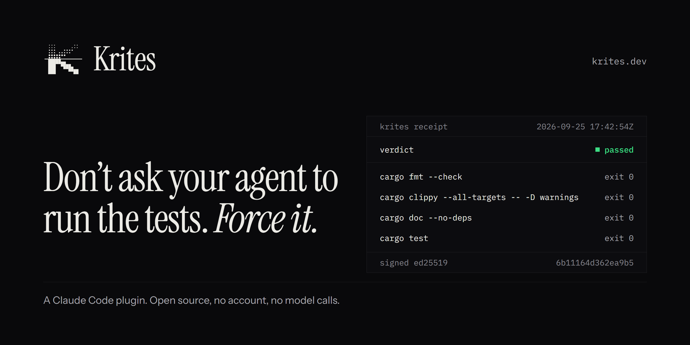

<picture>
  <source media="(prefers-color-scheme: dark)" srcset=".github/assets/banner-dark.png">
  
</picture>

# Krites

**Don't ask your agent to run the tests. Force it.**

[](https://github.com/krites-dev/krites/actions/workflows/test.yml)
[](LICENSE)

Krites is a verification harness for coding agents, shipped today as a free Claude Code plugin. When the agent tries to stop, Krites runs your repo's own checks itself and reads their exit codes. If one fails, the stop is blocked and the failure goes back to the agent, up to three times in a row by default. Krites also denies the agent's edit tools on the paths you protect, such as your tests and its own config, and signs a receipt of what ran that anyone can verify offline.

It is for anyone who lets Claude Code change a repo and wants "the tests pass" to mean a command ran and exited 0, not that the model said so. Open source, no account, no model calls. Pronounced KRY-tees.

```sh
claude plugin install krites@anthropic-plugin-directory
```

Requires Claude Code and Node 20 or later.

[Install](#install) · [Quickstart](#quickstart) · [How it works](#how-it-works) · [Commands](#commands) · [Receipts](#receipts) · [Configuration](#configuration) · [Known limits](#known-limits) · [Status and roadmap](#status-and-roadmap)

## Install

From Anthropic's plugin directory, which Claude Code includes as the built-in marketplace `anthropic-plugin-directory`:

```sh
claude plugin install krites@anthropic-plugin-directory
```

Inside a session, `/plugin install krites@anthropic-plugin-directory` does the same. The directory can serve an earlier release than this repo; `claude plugin list` shows the version you have.

From this repo:

```sh
claude plugin marketplace add krites-dev/krites
claude plugin install krites@krites
```

Install from one place only, so only one copy runs. To follow a tagged release instead of the default branch, see [Pinning a release](#pinning-a-release).

## Quickstart

1. **Install the plugin and start Claude Code in a git repo.** If the repo has a test command Krites recognizes and its program is on PATH, it is gated already, with no setup: the session start names the command the stop gate will run, or the program it could not find. See [Without a krites.toml](#without-a-kritestoml).

2. **Write a config.** Type `/krites:init` to see the `krites.toml` Krites would write for this repo, then `/krites:init-write` to write it. In a Rust repo it proposes:

   ```toml
   version = 1

   [checks]
   commands = [
     "cargo fmt --check",
     "cargo clippy --all-targets -- -D warnings",
     "cargo test",
   ]
   timeout_seconds = 600
   max_blocks = 3

   [protect]
   globs = ["tests/krites/**", "krites.toml", ".claude/settings.json", ".claude/settings.local.json", ".claude/hooks/**", ".claude/agents/**", ".claude/commands/**", ".claude/skills/**", ".mcp.json", ".claude/output-styles/**", ".claude/rules/**"]

   [receipts]
   dir = "receipts"
   ```

   Add the paths that judge the agent's work to `globs`, such as `tests/**`, run `/krites:init-write` again to approve your edit, and commit `krites.toml`.

3. **Work as usual.** Each time the agent tries to stop, Krites runs `commands` in order. The first failure blocks the stop and goes back to the agent with the command and its last 60 lines, and the agent keeps working. An edit tool aimed at a protected path is denied before the write lands.

4. **Sign the run.** Type `/krites:receipt` to write the last run as a signed JSON file and a Markdown rendering. Verify it with `node verify-receipt.js --key <fingerprint> <receipt.json>` from a checkout of this repo; the fingerprint is the last line of the Markdown. See [Receipts](#receipts).

### What happens in a session

A recording of the real hooks on a copy of the plugin's Rust test fixture, with `tests/**` protected and `cargo fmt --check` and `cargo test` as the checks. The `agent` lines are the tool calls and stops sent to the hooks; `src/lib.rs` was broken on purpose, then fixed. Every `krites` line is the text Claude Code hands the agent, word for word, and an empty one means the hook said nothing and the stop went through; `...` marks trimmed lines. The receipt was signed with a throwaway key; the published sample is under [Receipts](#receipts).

```text
agent   Edit tests/total.rs
krites  Blocked: tests/total.rs is protected. Protected paths are human-edited only.

agent   (breaks src/lib.rs, then stops)
krites  Krites refuted the stop: cargo test
        ...
        test total_sums_the_values ... FAILED
        ...
        assertion `left == right` failed
          left: 5
         right: 7
        ...
        test result: FAILED. 0 passed; 1 failed; 0 ignored; 0 measured; 0 filtered out; finished in 0.00s
        ...
        Fix it and let the checks run before stopping. Do not describe results; the gate reads them.

agent   (fixes src/lib.rs, then stops)
krites

> /krites:receipt
krites  receipts/2026-09-25T16-11-37Z-382ebfd1.json
        receipts/2026-09-25T16-11-37Z-382ebfd1.md
```

## How it works

Krites is Claude Code hooks and commands, written in Node with no runtime dependencies. Three hooks do the work, and a fourth, at each fresh session start, records HEAD as the session baseline the others compare against.

- **Protect.** Before an edit tool (`Edit`, `Write`, `NotebookEdit`, `MultiEdit`) writes, Krites denies it on the paths you name in `[protect].globs` and on what is always protected: every `krites.toml`, `.krites/` and `.git/`. An edit outside the repo goes to Claude Code's permission prompt, so you decide it; in the permission modes where no prompt can reach you it is denied. See [Edits outside the repo](#edits-outside-the-repo).
- **Gate.** When the agent tries to stop, Krites runs your checks itself, unless they already passed on the tree as it stands. The first failure blocks it and hands back the command and its last 60 lines.
- **Commit.** When the agent runs `git commit` through the Bash or PowerShell tool in a repo whose `krites.toml` has checks, Krites holds it unless the last check run passed on the changes as they stand now and the commit leaves none of them out (all staged, or carried by `-a`). Commits you make yourself, outside the agent's Bash and PowerShell calls, are never held.
- **Receipt.** `/krites:receipt` signs the last run: the commands, their exit codes, the files changed and the commit. Anyone can verify it offline with `verify-receipt.js`.

A run ends in one of four verdicts:

| Verdict | When |
| --- | --- |
| `passed` | Every check exited 0. |
| `refuted` | A check failed, or a protected path changed by any tool, Bash included. |
| `timed_out` | The run used up its time and its process tree was killed. The time is `timeout_seconds`, or less when the stop's shared 820 s budget is nearly spent, and 540 s in all under `/krites:verify`. |
| `no_checks` | No command is configured. The stop goes through, and the receipt says `no_checks`, never `passed`. |

Krites never says `verified`: the checks are yours, and nothing here vouches for them.

### The stop gate

- The gate judges every stop attempt. It runs the checks unless the tree is clean at the session baseline, or the latest recorded run already passed on the tree as it stands: the same `krites.toml`, the same HEAD, and the same content and git status in every changed or untracked file git does not ignore. That pass is carried, whether a stop or `/krites:verify` made it and in whichever session, so the stop goes through and nothing runs.
- Commands run in order, and the first failure ends the run. `[checks].slow` never runs at a stop.
- A failing check, a timeout or a changed protected path blocks at most `max_blocks` times in a row (default 3, 1 to 8). After that the stop is allowed, the run is recorded with the reason "attempt budget exhausted", and the next session start says so.
- A timeout blocks only once on an unchanged tree. When the agent stops again in the same session with nothing changed, and the gate has no more time to give than the run that timed out had (that run used at least 90% of what is available now), the checks are not run a second time: the stop goes through, you are told it went through unchecked, the record stays `timed_out`, and every session start says so until a run replaces it. Another session, a changed tree, or a run that was cut short because earlier roots used up the budget, gets the checks again.
- Every root one stop judges shares one 820 s budget, in order. Each root's run gets its `timeout_seconds` or what is left, whichever is less.
- Session start means a fresh startup: a resumed or compacted session keeps its baseline and its block count, and a `/clear` keeps the baseline but reports a chain that gave up and starts the count over, since the turn before it may have been interrupted with no stop. A chain that gave up is reported in place of a timeout when both apply.
- The count resets when a run passes, at a stop or under `/krites:verify`; when a stop carries an earlier pass or finds a clean tree at the session baseline; when a new session starts; and at a `/clear`.
- A `krites.toml` that cannot be read, or a repo in which git cannot list what changed, blocks every stop until it is fixed.

### Approving a protected change

The changed-path check compares against the session baseline, so a protected change refutes every stop of the session, even one a person made. For a protected path the reason tells the agent to undo its own change and leave a person's to a commit and `/krites:approve`; for `krites.toml` itself it points to `/krites:init`.

To approve a change a person made, commit it, then:

1. Type `/krites:approve`. It lists every protected path that differs between the baseline and HEAD, protected under the working `krites.toml`, the baseline's or HEAD's, so a narrowed one hides nothing; then the commits in between that changed them; then the diff for those paths.
2. Type `/krites:approve-write`. It refuses if HEAD or the baseline moved after `/krites:approve` showed them. Otherwise it records the approval and lists the commits and paths it approved.

What `/krites:approve` shows:

- The diff is read with `git --no-replace-objects` and no external diff or textconv driver. Control characters print as `\xNN` and format and separator characters as `\u{N}`.
- At most 200 lines are shown, and a cut names the full command, with commit ids and no path: `git --no-replace-objects --literal-pathspecs diff --no-ext-diff --no-textconv --text <baseline> <HEAD>`.
- When HEAD does not descend from the baseline the heading says the paths differ between the two, and the commit list can be empty, which it says.
- Protected paths where the working tree differs from HEAD are listed as not committed, so not approvable. A change staged and then reverted on disk is not listed, because the gate does not see it either.

What an approval covers:

- From then on a protected path refutes only when it differs from both the baseline and the approved commit, so a later change still refutes and a revert to the baseline does not.
- What is excused is the approved commit's content: the same content stays excused even if it later stops being committed (`git reset --soft`).
- The baseline does not move: the next stop still runs the checks on everything since the baseline, and only a pass or a new session moves it, which ends the approval (a `/clear` keeps both). `/krites:init-write` ends it too, since a changed `krites.toml` can protect a path the approval never showed.
- A change to `krites.toml` changes its `config_hash` and needs `/krites:init-write` to approve it, or, once committed, `/krites:approve-write` while the file matches the commit.

Both commands end with the telemetry question until it is answered; see [License and telemetry](#license-and-telemetry).

## Commands

You type these; the model cannot invoke any of them.

| Command | What it does |
| --- | --- |
| `/krites:init` | Shows the `krites.toml` it would write for this repo and the Node version it found. With a `krites.toml` already there, shows what it runs. Writes nothing. |
| `/krites:init-write` | Creates that `krites.toml`, or approves a `krites.toml` you edited yourself. |
| `/krites:approve` | Shows the protected paths that commits changed since the session baseline, with those commits and their diff. |
| `/krites:approve-write` | Approves those changes up to the HEAD `/krites:approve` showed. |
| `/krites:verify` | Runs `commands` and then `slow`, now, and prints each command, the last lines it printed and its exit code. |
| `/krites:receipt` | Writes the last run as a signed JSON file and a Markdown rendering under `receipts/`, or the `[receipts].dir` you set. |
| `/krites:telemetry` | Shows your telemetry answer, or the question while it is unanswered. |
| `/krites:telemetry-on`, `/krites:telemetry-off` | Answer the weekly ping question. See [License and telemetry](#license-and-telemetry). |
| `/krites:off`, `/krites:on` | Turn Krites off in every session at once, and back on. See [Turning Krites off](#turning-krites-off). |

## Receipts

[A real receipt](examples/receipts/2026-09-25T17-42-54Z-4a10c564.md) ([JSON](examples/receipts/2026-09-25T17-42-54Z-4a10c564.json)), the one krites.dev shows. Verify it from the root of this repo:

```sh
node verify-receipt.js --key 6b11164d362ea9b5 examples/receipts/2026-09-25T17-42-54Z-4a10c564.json
```

```text
valid: signed by 6b11164d362ea9b5c7711d8f5465d76c7d6da068a55f9b4253bd697171978bfa, verdict passed
```

`verify-receipt.js` is one file with no dependencies. It prints `valid: signed by <fingerprint>, verdict <verdict>` or `invalid: <why>`, and exits 0 or 1. It checks that the file's bytes are the canonical form of the receipt, that the verdict is one of the four, that the signature holds exactly `alg`, `public_key` and `sig` with `alg` set to `ed25519`, that the key and signature are canonical base64, that the signature matches, and, with `--key`, that the signer is the one you expect: the full fingerprint, or a prefix of at least 16 hex characters. The fingerprint is the lowercase hex SHA-256 of the raw 32-byte public key, and the last line of the Markdown rendering.

### What a receipt contains

| Field | Holds |
| --- | --- |
| `schema` | `krites.receipt/0.3` |
| `plugin_version` | The plugin version that made the run. |
| `created_at` | When the run was recorded, in UTC, as `YYYY-MM-DDTHH:MM:SSZ`. |
| `repo` | `root_hash` (the SHA-256 of the repo's path), `head` (the commit, empty when the repo had none) and `dirty`. |
| `diff` | `files_changed`, `insertions`, `deletions` and `files`: the changes since the session baseline (or since HEAD when there is no valid baseline), untracked files included, as a diffstat, not the diff itself. |
| `checks` | For each check that ran: `command`, `exit_code` (null when it was killed), `duration_ms` and `tail`, the last 60 lines of its combined output. |
| `verdict` | `passed`, `refuted`, `timed_out` or `no_checks`. |
| `reason` | Why the run did not pass; null for `passed` and `no_checks`. |
| `config_hash` | The SHA-256 of `krites.toml`, read with a leading BOM dropped and CRLF as LF; null when there is none. |
| `commands`, `slow` | Every configured check, as argument lists. |
| `not_run` | Each configured check that did not run. |
| `env` | The `[checks.env]` assignments as `NAME=value`, scrubbed. |
| `tree_fingerprint` | The fingerprint of the tree the gate judged. |
| `session_id` | The Claude Code session, or null for a run `/krites:verify` made. |
| `signature` | `alg`, `public_key` and `sig`. |

The signature covers the canonical JSON of every other field: keys sorted, two-space indent, a trailing newline. The file is named `<created_at, with : as ->-<the first 8 characters of head, or nohead>.json`, with the Markdown rendering beside it as `.md`.

### What a receipt proves

A receipt proves which commands ran, with which exit codes, on which changed files, at which commit, under which `krites.toml` (`config_hash`). It does not prove your tests are good; it proves they ran.

- A signature proves the receipt was not altered after signing. It proves who signed only if you pin the key with `--key`: anyone can make a key and sign a receipt they wrote by hand, and without `--key` the valid line ends with `signer not pinned (pass --key)`.
- A receipt is evidence from a machine you trust, not proof against the agent that ran on it. What gets signed is `.krites/last-run.json`, and the key, `signing-key.pem`, sits in your Krites config directory (`KRITES_CONFIG_DIR` when set, else `%APPDATA%\krites` on Windows and `$XDG_CONFIG_HOME/krites` or `~/.config/krites` elsewhere), never in the repo: an agent with a shell can rewrite the first before you export, or read the second and sign on its own.
- `/krites:receipt` refuses when there is no recorded run, when the run file is one the gate could not have written, when the tree changed since the run, while Krites is off, and while a settings file definitely turns its hooks off. A carefully forged run file still passes, and the stop gate carries a forged pass on an unchanged tree as it would a real one. Export receipts from a session you watched, or from CI.
- `root_hash` is the hash of the repo's path, so a short, guessable path can be recovered from it.
- Asking for a receipt twice for one run points at the file already written, whatever changed since. For a receipt of the tree as it is now, run `/krites:verify` first.

## Configuration

### krites.toml

`/krites:init` proposes a `krites.toml` from the first of these it finds in the repo:

| Found | Proposed `commands` |
| --- | --- |
| `Cargo.toml` | `cargo fmt --check`, `cargo clippy --all-targets -- -D warnings`, then `cargo test`, or `cargo nextest run` with `.config/nextest.toml` |
| `package.json` | Its `typecheck`, `lint` and `test` scripts (not the `test` script `npm init` writes), run with pnpm, yarn or npm by lockfile; with none of them, `npx tsc --noEmit` if there is a `tsconfig.json` |
| `pyproject.toml` or `pytest.ini` | `ruff check`, `pytest` |
| `go.mod` | `go vet ./...`, `go test ./...` |

With none of them it proposes nothing, and you write `krites.toml` by hand. The proposal also protects `tests/krites/**`, `krites.toml`, Claude Code's project settings, hooks, agents, commands, skills, output styles and rules under `.claude/`, `.mcp.json`, and the scripts the repo's own hook settings run. A minimal hand-written one:

```toml
version = 1

[checks]
commands = [
  "cargo fmt --check",
  "cargo test",
]
timeout_seconds = 300

[protect]
globs = ["tests/**"]
```

| Key | Default | Meaning |
| --- | --- | --- |
| `version` | required | Must be `1`. |
| `[checks].commands` | `[]` | Run in order at a stop, unless they already passed on the same tree; the first failure blocks it. |
| `[checks].slow` | `[]` | Run only under `/krites:verify`, after `commands` and only when every one of them passed. |
| `[checks].timeout_seconds` | `600` | Time for one run of the checks, 1 to 820. |
| `[checks].max_blocks` | `3` | The attempt budget: blocked stops in a row before a stop is let through, 1 to 8. |
| `[checks.env]` | none | `NAME = "value"` lines every check gets. |
| `[protect].globs` | `[]` | Paths the edit tools may not touch, on top of `krites.toml`, `.krites/` and `.git/`. |
| `[receipts].dir` | `"receipts"` | Where `/krites:receipt` writes: a relative path inside the repo, outside `.git`, `.krites` and `.claude`, with no `..`. |

- The file is a small subset of TOML: whole numbers, double-quoted strings and arrays of strings, with comments. An unknown table or key is an error, and so is one given twice.
- A command is a string, split on spaces and tabs, or an array of strings when an argument holds a space. It may not hold a control character or any of `"` `'` `` ` `` `|` `&` `;` `<` `>` `$` `%` `^` `!` `*` `?` `(` `)`, may not end with a backslash, and as a string may not start with `-`.
- A check is an argument list, not a shell line, so `GOTOOLCHAIN=go1.26.6 make vulncheck` sets nothing. Put the variable in `[checks.env]` (`GOTOOLCHAIN = "go1.26.6"`), and every check gets it, at a stop and under `/krites:verify`. Names are letters, digits and `_`, not starting with a digit, and two names may not differ only in case. Values are used as written, with no `$VAR` expansion, and may not hold a control character, `"`, `&`, `|`, `<`, `>`, `^`, `%` or `!`.
- A stop never starts a slow check, and the receipt of a run a stop made lists them as not run. A stop on the tree a `/krites:verify` passed runs nothing and keeps that run as the record, slow results included.
- Krites records the hash of each repo's approved `krites.toml` in `trusted-configs.json` in your Krites config directory. A newly cloned repo's `krites.toml`, or one that changed between sessions (such as from pulling a pull request), does not run its checks at a stop or under `/krites:verify` until you review it with `/krites:init` and approve it with `/krites:init-write` (or `/krites:approve-write` for a committed change).
- Commit `krites.toml`. One that was never committed can be deleted, and does not exist in a `claude -w` worktree session; see [Known limits](#known-limits).

### Without a krites.toml

Until a repo has a `krites.toml`, Krites runs with no setup: in a git repo where `/krites:init` would propose a test command (`cargo test`, or `cargo nextest run` with `.config/nextest.toml`; `npm test`, `pnpm test` or `yarn test` for a `test` script other than the one `npm init` writes; `pytest`; `go test ./...`), the stop gate runs that one command, and the session start says so in one line. Run `/krites:init` to customize.

- The command is chosen at each fresh session start and recorded in `.krites/zero.json` with HEAD and a fingerprint of the tree. A stop is skipped while the tree is as that session found it, or as it last passed in any session, so a question-only turn runs nothing. A failing run blocks the stop at most 3 times, with 600 s for the command, as `/krites:init`'s defaults.
- The repo is the git top level of the project directory. A folder outside git, a repo at your home folder, a repo with no test command, and a command whose program is not on the PATH (the session start names it) are not checked.
- The edit tools are denied on `krites.toml`, `.krites/`, `.git/`, and any `.claude/settings.json` or `.claude/settings.local.json` in the repo; on Claude Code's and Krites's own configuration outside the repo, except this project's memory folder; and on network paths and device paths other than a drive letter's (`\\?\C:\`), which can lead back into the repo unseen. Every other path is open, outside the repo included.
- pytest runs with `PYTHONDONTWRITEBYTECODE=1`, so its bytecode does not change the tree while the gate runs.
- `/krites:verify` runs the same command. `/krites:receipt` signs its run, with no config hash: the Markdown says `Config hash: none (no krites.toml)`. `/krites:approve` has nothing to approve until there is a `krites.toml`. After `/krites:init-write` mid-session, the gate and `/krites:approve` judge from the head recorded at the session start or the last pass, or from the empty tree if the repo had no commit then.
- The agent's `git commit` is not held until there is a `krites.toml`.
- `KRITES_ZERO_CONFIG=off` (any case) in the environment Claude Code starts with turns this off for every repo. To stop gating one repo, see [Stopping the gate](#stopping-the-gate).

### Edits outside the repo

Outside the repo the edit tools write freely in two places: this project's Claude Code memory folder in its default place, and the scratchpad Claude Code names for the session (`scratchpad_dir` in the hook input, Claude Code 2.1.257 or later), which is this session's alone. Either one that is a link gets no exception, and either one inside the session's repo is judged as part of the repo.

Any other edit outside the repo is handed to Claude Code's permission prompt, with a reason from Krites that names the file. Approve it and that one edit goes through.

- Krites asks only in the permission modes where a prompt can reach you: `default`, `acceptEdits`, `plan` and `auto`, where the session waits for your answer. In every other mode, `bypassPermissions` and `dontAsk` among them, the edit is denied.
- A `-p` run reports the `default` mode, so Krites asks there too. Claude Code's hooks docs say that where no one can answer, the agent reads the reason in the tool result instead.
- Never asked and always denied: a protected path, a path written as a network share, and Krites's and Claude Code's own configuration, the plans folder under `~/.claude` included. A path that runs through the repo and leaves it by a link is never asked about either: it is denied unless `allow_outside` opens its target.

To open folders outside the repo to the edit tools for good, with no prompt, list them in `config.toml` in your Krites config directory, not in the repo, so a repo you clone cannot decide where in your home folder the agent may write:

```toml
[protect]
allow_outside = ["~/.claude-work/**"]
```

- Each entry is a glob that starts with `~/`, `/`, or a drive letter such as `C:/`, matched against the target's real path after links are followed. The entry itself is not resolved, so name the real folder (on macOS, `/private/tmp`, not `/tmp`).
- A relative entry is an error. Until it is fixed, every edit outside a repo that has a `krites.toml` is denied, except in the memory folder and the scratchpad.
- An entry naming a network share matches nothing. Matching ignores case on Windows and macOS, and `**` matches what is under a folder, not the folder itself.
- The Krites config directory, `~/.claude`, `~/.claude*.json` and a non-empty `$CLAUDE_CONFIG_DIR` stay closed whatever the list says.
- A broad entry such as `~/**` still opens shell startup files, which can set `CLAUDE_CONFIG_DIR` or move the Krites config directory for the next session, so keep entries to the folders your workflow writes.

Claude Code can tell a session to keep temporary files in a scratchpad outside the repo. Krites opens the one Claude Code names for the session and no other session's. A Claude Code older than 2.1.257 does not tell the hook where it is, so an edit there is asked about like any outside path. On Windows the scratchpad has been seen at `C:\Users\<you>\AppData\Local\Temp\claude\<project>\<session id>\scratchpad`; Claude Code does not document the place, so check the path your own session names. For that place, this entry opens the scratchpad folders and nothing beside or above them, for every session at once, so one session's edit tools can also write another's:

```toml
[protect]
allow_outside = ["~/AppData/Local/Temp/claude/*/*/scratchpad/**"]
```

If your session names another path, for example because `TEMP` points elsewhere, write the entry for that path instead.

### Nested repos and worktrees

A folder inside the session's repo with a `krites.toml` of its own, such as a nested repo or a git worktree, keeps its own protected paths.

- From a session in the outer repo, an edit there is checked against the outer repo's globs and then each such folder's, each on the path relative to its own folder.
- A session started inside such a folder takes it as the outer repo: the repos around it do not apply.
- A nested `krites.toml` that does not load, or a nested `.krites/session-head` with no `krites.toml`, blocks every edit below it until it is fixed from a session started there.
- Nested folders are found by their files alone, so a nested repo whose committed `krites.toml` is missing from its tree is not one, and a target opened by `allow_outside` is held to no nested folder's globs.

### Stopping the gate

To stop gating a repo, commit a `krites.toml` whose `[checks]` has `commands = []`. No check runs and no commit is held, but protected paths stay protected, and a changed one still refutes the stop. To leave every repo without a `krites.toml` unchecked, start Claude Code with `KRITES_ZERO_CONFIG=off`.

Deleting `.krites/` and `krites.toml` does not stop gating. When HEAD does not track `krites.toml`, the repo falls back to the no-setup test command; when it does, every edit and stop is blocked with "krites.toml is tracked but missing from the tree. Run /krites:init." If a stop is blocked with "krites.toml is missing from a repo that Krites gated before", for instance after checking out a branch that predates it, restore the file or delete `.krites/`.

### Turning Krites off

`/krites:off` turns Krites off in every session on the machine at once, the running ones included, with no restart. Until `/krites:on`, no edit is denied or asked about, no commit is held and no stop runs a check. Every session start and every stop says Krites is off, `/krites:verify` still runs the checks and says so too, and `/krites:receipt` signs nothing. The model cannot invoke either command: you type them. The switch is a file named `off` in your Krites config directory, where the edit tools never write while Krites is on. Nothing is forgiven while it is off: a protected path changed meanwhile is refuted at the first stop after `/krites:on`.

## Pinning a release

An install from this repo follows its default branch; Claude Code leaves auto-update off for a third-party marketplace by default, so nothing changes until you update it. Every release is tagged `krites--v<version>`, the version in `.claude-plugin/plugin.json`. The release script never moves a pushed tag, but a tag can be moved by hand on GitHub, so pin the commit too when that matters. If you installed from the directory, run `claude plugin uninstall krites@anthropic-plugin-directory` first, so only one copy runs.

```text
/plugin marketplace add https://github.com/krites-dev/krites.git#krites--v<version>
/plugin install krites@krites
```

A team marketplace can pin the commit with an entry in the `plugins` array of its `marketplace.json`; a `github` source takes `ref` and `sha`, and when both are set the `sha` is the effective pin.

```json
{
  "name": "krites",
  "source": { "source": "github", "repo": "krites-dev/krites", "ref": "krites--v<version>", "sha": "<the tagged commit, 40 lowercase hex characters>" }
}
```

The tags are annotated, so the commit is the `^{}` line of `git ls-remote https://github.com/krites-dev/krites.git "refs/tags/krites--v<version>*"`.

To vendor it instead: `git clone --depth 1 --branch krites--v<version> https://github.com/krites-dev/krites.git vendor/krites`, review it, delete `vendor/krites/.git`, commit it, and add it with `/plugin marketplace add ./vendor/krites`.

Sources: [Discover and install plugins](https://code.claude.com/docs/en/discover-plugins), [Plugin marketplaces](https://code.claude.com/docs/en/plugin-marketplaces) and [Plugin sources](https://code.claude.com/docs/en/plugins/marketplace-reference#plugin-sources).

## Known limits

### What Krites does not do

- It does not judge your checks. A run passes when every command exits 0, whatever the commands test.
- It does not stop a shell. The protect hook covers the edit tools only; Bash, any subprocess, and MCP tools that write files can write anywhere. In a repo with a `krites.toml`, a protected path changed that way refutes the next stop, up to the attempt budget; it is not prevented. With no `krites.toml`, no stop judges protected paths.
- It is not a boundary against a hostile agent with a shell, which can write `.krites/`, create the off switch or read the signing key, as the limits below describe.
- It makes no model calls and does no routing between agents.

### Protect hook

- The off switch is a file in your Krites config directory, so an agent with a shell can create it, or run `cli.js off`, as it can write anything else there. The line at every session start and every stop is how you would see it. A gate already running its checks when Krites is turned off finishes them and then lets the stop through.
- The prompt for an edit outside the repo is Claude Code's; Krites only asks for it. Krites does not see the answer, whoever or whatever gives it, a permission rule or setting of yours included, and does not record an edit approved there.
- The agent can edit what your checks read, such as `scripts.test` in `package.json` or a lint config. Protect those paths if that matters to you.
- With no Node on the PATH the hooks cannot start, and Claude Code lets a hook that fails to start, or that outlives its timeout, through.

### Stop gate and record

- A carried pass and a timeout let through both rest on `.krites/last-run.json` and the tree's fingerprint. A change only in files git ignores, or in what a check reads outside the repo, is not seen, so the checks are not run again for it. `/krites:verify` runs them again, unless a protected path changed or its 540 s are spent.
- A `krites.toml` edited through Bash refutes every stop until `/krites:init-write` accepts it or the attempt budget runs out. A fresh session start does not accept an unapproved `krites.toml`, and `cli.js init --write` run through Bash accepts it as a person would. A receipt's `config_hash` and `commands` show which checks a run really covered.
- `.krites/` and `.git/` are not in any diff, so tampering there through Bash is invisible, and so are files hidden with `.gitignore`, a global exclude (`core.excludesFile`), `assume-unchanged` or `skip-worktree`. Ignored files stay out on purpose: Claude Code itself writes `.claude/settings.local.json` on standing permission approvals ([settings](https://code.claude.com/docs/en/settings)), so judging it would refute the stop after the person's own click.
- `cli.js approve` run through Bash, or a hand-written `.krites/approve-pending`, arms `/krites:approve-write`, which records the approval first and lists the commits and paths after it. Run `/krites:approve` yourself right before `/krites:approve-write`. `cli.js approve --write` run through Bash, or a hand-written `.krites/approved-head`, approves as a person would, and as invisibly as any `.krites/` write.
- A missing or damaged baseline narrows the changed-path check to the diff against HEAD, and a block counter written by hand ends the blocking early.
- What `/krites:approve` shows reaches you through the model's reply, as `/krites:init`'s does, and a scrubbed line hides text, so run `git --no-replace-objects --literal-pathspecs diff --no-ext-diff --no-textconv --text` between the baseline and HEAD yourself when in doubt.
- A `krites.toml` that was never committed can be deleted along with `.krites/`, which drops the repo back to the no-setup test command, and does not exist in a `claude -w` worktree session. Commit it.
- A commit made after the last gate of a session that was killed rather than stopped is not gated in the next session, and neither is one made on another branch and reached by checking back out. Work moved out of the tree before a stop (a stash, another branch) makes that stop a clean one: it resets the attempt count, and the next session start no longer reports attempts that gave up.
- The attempt budget is per `krites.toml`. In recorded print-mode sessions Claude Code honored eight Stop blocks in a row and let the ninth through (no interactive session was recorded), so several failing roots in one session can ask for more blocks than it grants; the last run then says refuted without the exhausted reason. After the watchdog or a crash, roots behind the interrupted one are not judged in that stop.
- If `.krites/block-count` cannot be written, the gate keeps blocking and the reason names the file and the error code. There, and for a `krites.toml` that cannot be read, what ends the chain is Claude Code letting the ninth stop through, and no gave-up run is recorded.
- `/krites:verify` names a settings file that turns Krites's hooks off, and `/krites:receipt` refuses while one definitely does. Both read the settings files only (user, project, local, and the managed file with its `managed-settings.d` drop-ins), not managed settings from the Windows registry, a macOS plist or the server, or a `--settings` file.

### Nested roots

- A nested repo or worktree inside the project root, with its own `krites.toml`, is judged at every later stop of a session, whatever the cwd, once an edit tool wrote in it. Work there through Bash alone is not seen by the protect hook, so it is judged only from a cwd inside it.
- Every root of a stop shares the one 820 s budget, judged in order, so several such roots with long checks can time the last one out.
- `/krites:verify` and `/krites:approve` reach the cwd and project roots only, so a protected change a person commits in a nested root keeps refuting the outer session's stops until that root's attempt budget is spent; a session started in that root begins from its HEAD, which clears it.
- A nested root recorded with no HEAD, and with no baseline of its own, is judged as a root the session never saw, and a recorded HEAD that no longer exists there (history rewritten and pruned) leaves its changed-path check against HEAD.
- A record made while a stop trims a `.krites/touched` past 4096 lines can be lost, and a trim past 4096 lines drops other sessions' oldest lines, so a long-lived session (a resumed one) can lose its line for a nested root, which its next edit there records again.
- An edit in a repo outside the project root (an added directory) counts as a repo edit only when the cwd is inside that repo: it is recorded there and judged only from a stop whose cwd is inside that repo. From any other cwd it is an edit outside the repo, and nothing is recorded.
- When no krites root holding `CLAUDE_PROJECT_DIR` holds the nested root (or the variable is unset), the record goes to the outermost session root holding the edit, so a later edit from a cwd in a root between the two can record a later HEAD there, and which HEAD the gate takes depends on which root it reads first.

### Commit hold

- The commit hold reads the command text, so `sh -c`, scripts, aliases, `GIT_DIR`, wrappers (`timeout`, `nohup`, `exec`, `sudo`), git options before `commit` other than `-C`, `-c`, `--no-pager` and `-P`, a PowerShell `( )` group among the paths, and `merge`, `rebase`, `cherry-pick` and `revert` are not seen, and `push` is not held.
- The directory a commit runs in is tracked on a best-effort basis: a pipeline, two `cd -` in a row, the branches of an `if`, a `case` inside `$( )`, and `pushd` or `popd` options such as `+1` or `-n` can mislead it, and a directory named through a variable holds the commit inside a repo whose `krites.toml` has checks.
- The index is read before the command line runs, so a `git add` earlier in the same line does not count: stage in a call of its own.
- Commits are judged whole, so checked work cannot be split over several commits, and untracked scratch files in the repo hold every commit until they are ignored or removed.
- A commit is judged by the root of the directory it runs in and only on that root's paths, so one made from a root inside a larger repo carries whatever is staged outside it, or with `-a` modified, unjudged. A submodule's dirty tree is not seen, nor which commit it moved to once it differs from the one committed.
- A commit hook that crashes, or outlives its 30 s timeout, lets the call through.
- With a clean tree at the session baseline the stop gate runs no checks, so a commit held there (an `--amend`, say) goes through only after `cli.js verify`.
- It is an accident guard, not a boundary.

### No-setup mode

- With no `krites.toml` the test command is a guess. A test script that starts a watcher runs to the 600 s timeout; a suite that already fails blocks a stop that changed something, up to 3 times; and a command that writes files the repo does not ignore, such as `cargo test` with no `target/` entry in `.gitignore`, changes the tree while the gate runs, which blocks the same way. `/krites:init` shows the guess and fixes it.
- No-setup mode assumes you trust the repository to run its detected test command (`scripts.test` in `package.json`, `cargo test`, `pytest` or `go test ./...`) once the tree changes. Start Claude Code with `KRITES_ZERO_CONFIG=off` when opening untrusted repositories.
- The edit tools can change what the command runs, such as `scripts.test` in `package.json`, and nothing protects it until a `krites.toml` does.
- Deleting `.krites/` through Bash switches the no-setup gate off until the next fresh session start, and a nested root with its own `krites.toml` inside such a repo is gated only from a session started in it.
- The record is one per repo: a second session started there moves its head, as a second session does to a `krites.toml` repo's baseline, so work the first session committed before that start is not gated; uncommitted work still is. A `/clear` in either session takes the startup tree over, since the hook cannot tell which session wrote it.

### Time and file size

- `/krites:verify` runs through Claude Code's Bash tool, which allows at most 600 s on default settings, and only when the model passes the 600000 ms timeout the command asks for. Its checks, for all roots together, are cut off at 540 s, and a `slow` check shares that budget with `commands` and the roots before it; one still running when it is spent is killed and recorded as timed out. The stop gate allows up to `timeout_seconds` (at most 820). Suites longer than that belong in CI.
- Killing a timed-out check takes its process tree with it, except descendants that detached themselves; under a PID 1 that does not reap, killed processes can linger as zombies.
- Files over 5 MB, or past 64 MB in one pass, are fingerprinted by size and modification time, so a same-size in-place edit there is not seen during a run, nor by the commit hold after one.

## Status and roadmap

- **Today:** the Claude Code plugin in this repo, free and open source.
- **Next:** Codex and OpenCode adapters, free, with the same protected paths, stop gate and signed receipts.
- **In development:** Krites Pro, with the switcher, which tracks headroom on each agent plan and moves a task to one with room, and the observatory, which shows first-try pass rate and cost per verified pass for each agent and model, measured on your own runs.

There are no cost claims for Pro until measured runs back them. See [krites.dev](https://krites.dev).

## License and telemetry

The plugin is licensed under Apache-2.0; see [LICENSE](LICENSE). Krites is open core: everything in this repo is Apache-2.0, and some parts of Krites built outside it are proprietary.

Telemetry is off until you are asked and say yes.

- The question ends `/krites:init`, `/krites:init-write`, `/krites:approve`, `/krites:approve-write`, `/krites:verify` and `/krites:receipt` until you answer it, and `/krites:telemetry` shows it meanwhile. A hook never asks.
- After a yes, Krites sends a ping to https://krites.dev/ping now and once a week: `{ "install_id": "<random uuid>", "version": "<plugin version>", "os": "<the Node platform, such as win32, darwin or linux>", "ts": "<time>" }`, and nothing else.
- The install id is random but stays the same from one ping to the next, so the ping is pseudonymous, not anonymous.
- The endpoint is a Cloudflare Worker run by Krites. It stores the install id, version, OS and timestamp and the day the ping was received, one row per install per day, and keeps them for 12 months. It does not store your IP address or any request header; the IP address is used only as the rate limiter's key.
- The ping leaves at most once a week, from the first allowed stop or Krites command of that week, in whichever repo that happens, with or without a `krites.toml`. It never leaves from a blocked or timed-out stop and never changes a verdict.
- `/krites:telemetry-off` is permanent until you run `/krites:telemetry-on`. The answer is stored next to the signing key, never in a repo.
- The `KRITES_PING_ENDPOINT` environment variable wins over the built-in endpoint, and `KRITES_PING_ENDPOINT=off` (any case) switches telemetry off altogether: nothing is asked and nothing is sent. An empty value uses the built-in endpoint.

See the [privacy policy](https://krites.dev/privacy).

## Security and contact

Report a vulnerability privately to hello@krites.dev, not in a public issue; see [SECURITY.md](SECURITY.md). Bugs and questions go to [GitHub issues](https://github.com/krites-dev/krites/issues). Krites is built by Quinn Lott.

[krites.dev](https://krites.dev) · hello@krites.dev
